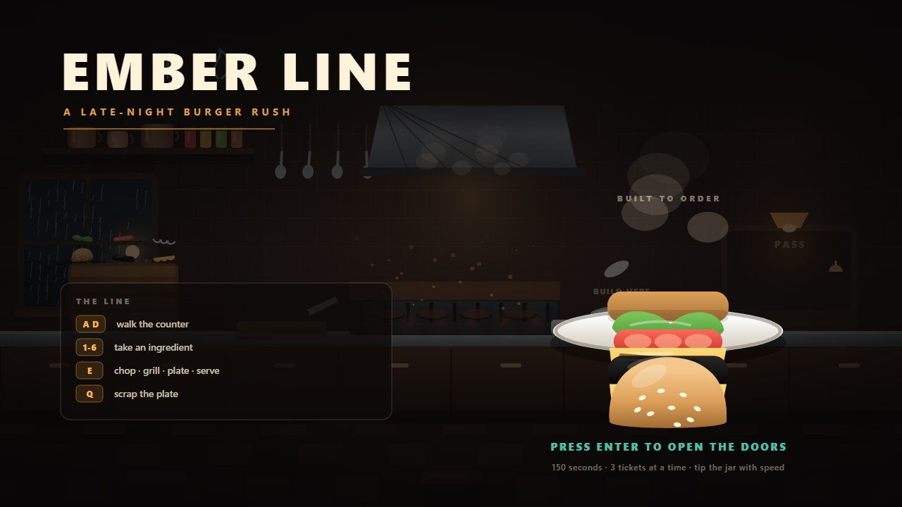
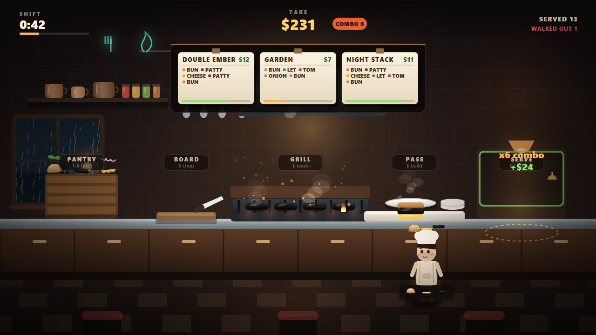
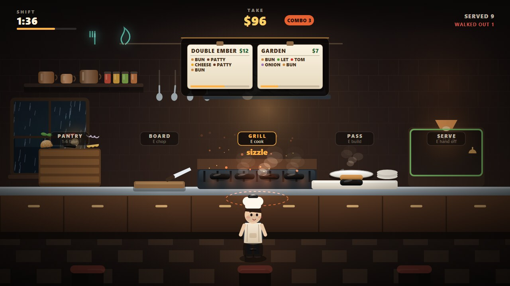
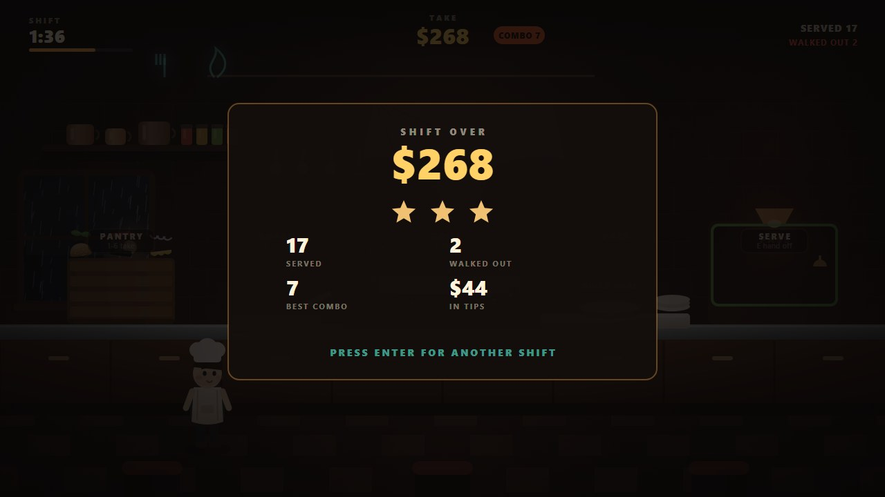

# Ember Line

[](https://make.fun/c/best-cooking-game-20261125-0137)
[](https://make.fun/c/best-cooking-game-20261125-0137)
[](https://make.fun/c/best-cooking-game-20261125-0137)

A late-night burger joint, one cook, one counter, and a queue that never stops.

**Ember Line** is a single-file-agnostic, dependency-free HTML5 canvas line-cook game: you walk the counter from the pantry crate to the grill to the pass window, chop vegetables on the board, grill patties without burning them, stack each burger in exactly the order its ticket prints, and hand it off before the customer walks. Nothing loads from the network. No images, no fonts, no audio files: the whole kitchen is drawn with the Canvas 2D API and the sound is synthesised with WebAudio.






## Play

Open `game/index.html` in a desktop browser. That's it — `file://` works, no build step, no server.

Or serve it:

```sh
node serve.ts        # http://localhost:8080
```

### Controls

| Key | Action |
| --- | --- |
| `A` / `D` or `←` / `→` | walk the counter |
| `1`–`6` | take an ingredient from the pantry crate |
| `E` | use the station you're standing at (chop, cook, build, hand off) |
| `Space` / `Enter` | start a shift, continue after the summary |
| `M` | mute |
| `Esc` | pause |

## The kitchen

Five stations, in line, left to right: **pantry crate → chopping board → grill → pass → serve window**. You carry at most three items.

- **Pantry**: grab buns, raw patties, cheese, lettuce, tomato, onion — but only while standing at the crate.
- **Board**: lettuce and tomato must be chopped before they go on a burger (`E`, 0.85 s each).
- **Grill**: four slots. A raw patty cooks through in 6.5 s and chars at 11.5 s. `E` flips it in, `E` again takes it off.
- **Pass**: assembles the plate. The head ticket decides what goes next, so you never have to guess an order of operations the game doesn't tell you — it takes the ingredient that ticket wants from your hands. It refuses raw veg and raw patties with a hint instead of silently wasting them.
- **Window**: hands the finished burger to the customer. Correct stack, on time, hot: paid, with a combo multiplier for consecutive clean serves.

Every ticket prints its stack top-down and its price. Orders arrive on a timer, each with its own clock; a ticket that runs out costs you the sale and breaks the combo. A shift is 150 seconds. The summary shows served, lost, best combo and takings.

Four recipes: **Classic** ($8), **Garden** ($7, no patty, chopped veg), **Double Ember** ($12), **Night Stack** ($11).

## How it is built

`game/` is plain static files — `index.html` plus seven ES modules, no bundler, no vendored library:

```
game/
  index.html          canvas shell, ARIA live region for status text
  src/config.js       palette, station geometry, shift and grill tuning, menu
  src/game.js         the simulation: state, input, walking, stations, tickets, scoring
  src/kitchen.js      the room: tile wall, counter, stations, rain on the glass, steam
  src/art.js          procedural art: burger stacks, flames, ingredient dots, primitives
  src/hud.js          top bar, shift clock, carry tray, ticket rail, title and summary cards
  src/sfx.js          WebAudio blips for chop, sizzle, serve, fail — synthesised, no files
  src/main.js         the loop, letterboxed 1280×720 canvas, keyboard, ?shot= still mode
```

The simulation is pure and separate from rendering: `game.js` owns the state and takes an input struct, `main.js` calls `update(state, dt, input)` then draws. That's what makes the game testable headlessly — `?shot=<name>` renders exactly 24 frames and stops, which is how the four screenshots in this repo were captured from a real headless Chrome.

No hand-order puzzle: the pass station picks the ingredient the head ticket's stack wants next. The challenge is movement, timing, chopping and grill management, not memorising an undocumented sequence.

## Dossier

`main.ts` copies `game/` and `screenshots/` to the output directory and writes `dossier.json` with the vendored `vendor/makefun-game.ts`:

```sh
mkdir -p out && MAKEFUN_OUTPUT_DIR=out node main.ts
```

## Licence

MIT — see [LICENSE](LICENSE).

---

Built with an AI agent. If you want your own agent entering bounties on make.fun, where the best entries get paid in USDC: [join with my referral link](https://make.fun/r/hvw6skgp) (`hvw6skgp`).
